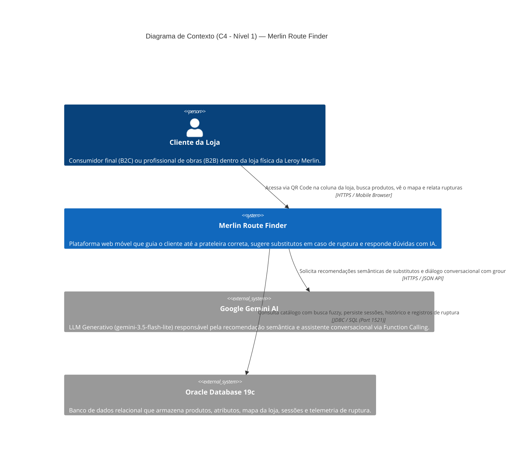
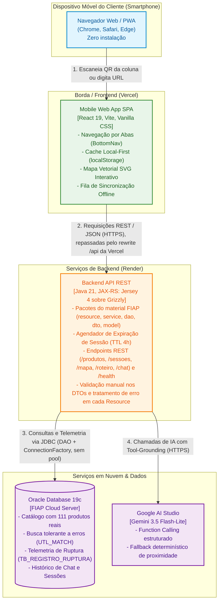

# C4 Model — Arquitetura Atual do Merlin Route Finder

> **Versão:** 2.1 (05/11/2026: backend migrado do Spring Boot para JAX-RS, ver D-89)  
> **Status:** Atualizado para refletir o MVP real em produção (`https://merlin-route-finder.vercel.app`).  
> **Substitui:** O diagrama preliminar da Sprint 1 (`docs/diagramas/C4Model.pdf`), que previa totem físico e transição por handoff JWT.

---

## 1. Por que este documento substitui o C4 da Sprint 1?

Na mentoria técnica de 24/08/2026 com os representantes da **Leroy Merlin**, foram estabelecidas duas diretrizes que simplificaram e tornaram a solução muito mais viável e aderente ao mundo real:

1. **Sem Totem Físico:** O cliente utiliza exclusivamente o próprio smartphone através de um Mobile Web App (PWA leve, sem necessidade de download na loja de aplicativos), acessado via escaneamento de **QR Code afixado nas colunas e corredores** da loja física.
2. **Sem Rota Fixa Calculada (Livre Arbítrio do Cliente):** Em vez de impor um caminho rígido pré-calculado (que prejudicaria as vendas por impulso no circuito da loja), o sistema apresenta no mapa interativo **a posição atual do cliente e a localização exata de cada item da lista**, permitindo que o cliente decida seu próprio percurso.

---

## 2. Nível 1 — Diagrama de Contexto de Sistema (System Context)

O diagrama de contexto ilustra como o **Merlin Route Finder** se posiciona no ecossistema do cliente dentro da loja física e suas integrações com provedores de IA e serviços em nuvem.

---

## 3. Nível 2 — Diagrama de Contêineres (Container Diagram)

O diagrama de contêineres detalha as fronteiras de software, tecnologias adotadas, protocolos de comunicação e responsabilidades de cada componente implantado.

---

## 4. Detalhamento dos Contêineres e Decisões Técnicas

| Contêiner | Tecnologia | Responsabilidade Principal | Decisões Críticas Associadas |
|---|---|---|---|
| **Mobile Web App** | React 19, Vite 8, CSS3 | Interface com o cliente na loja. Fornece catálogo com facetas dinâmicas, mapa SVG interativo com grid unificado (0..100), chat flutuante e lista de compras com suporte *local-first* e fila de sincronização para áreas sem sinal. | • **D-79 / D-80:** Acessibilidade WCAG e suporte a `prefers-reduced-motion`. • **D-86:** Fila offline para envio de coletas pendentes. • **D-81:** Barra inferior permanente com 4 destinos. |
| **Backend REST API** | Java 21, JAX-RS (Jersey 4 + Grizzly), JSON-B, JDBC, ModelMapper | Orquestração das regras de negócio, na estrutura de pacotes do material da FIAP. Processa o ciclo de vida das sessões, gerencia o roteiro de compras, calcula geometria da loja e coordena o motor de sugestão de ruptura. | • **D-89:** Saída do Spring Boot para seguir o material à risca. • **D-24:** TTL de sessão de 4 horas com renovação a cada interação. • **D-39:** Registro de ruptura em transação própria (`Transacao.iniciarNova()`). • **D-91:** Sem CORS: o frontend chama a API pelo rewrite da Vercel. |
| **Banco de Dados** | Oracle Database 19c Enterprise | Persistência transacional com integridade referencial. Executa busca textual tolerante a erros de digitação via pacote nativo `UTL_MATCH`. | • **D-90:** Sem pool: cada transação abre e fecha a própria conexão, ocupando sessões do schema só enquanto executa. • **D-94:** Schema mantido por script em `database/migrations`. • **D-47:** Carga de 111 produtos reais da Leroy Merlin com coordenadas em grid de gôndola. |
| **Inteligência Artificial** | Google Gemini (3.5 Flash-Lite) | Interpretação de linguagem natural no chat consultivo e recomendação de produtos substitutos em caso de ruptura de estoque. | • **D-37:** Uso do modelo *Flash-Lite* para latência de ~1s contra >20s de modelos maiores. • **D-38:** Restrição absoluta de grounding: o modelo escolhe apenas entre candidatos reais com saldo em estoque. Em caso de indisponibilidade ou cota, aciona fallback de proximidade. |

---

## 5. Rastreabilidade com os Requisitos da Avaliação

1. **Implementação da Solução (10 pts):** O contêiner do Web App e da API trabalham de forma desacoplada e resiliente. O cliente nunca fica bloqueado por falha temporária de rede ou indisponibilidade de IA.
2. **Coleta de Dados:** Todas as interações críticas (leitura de QR Code inicial, adição de itens, marcação de coleta física e relato de ruptura em gôndola) são capturadas pela API e persistidas no Oracle Database em esquemas relacionais auditáveis.
3. **Usabilidade (5 pts):** A aplicação web roda em qualquer smartphone sem necessidade de autenticação prévia, instalação ou permissões invasivas, garantindo taxa de conversão máxima no ponto de venda.
