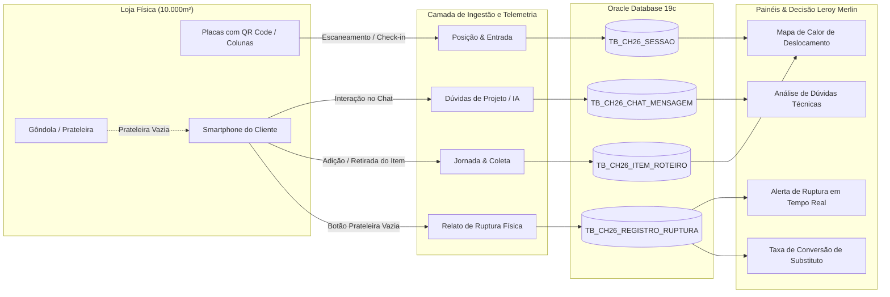
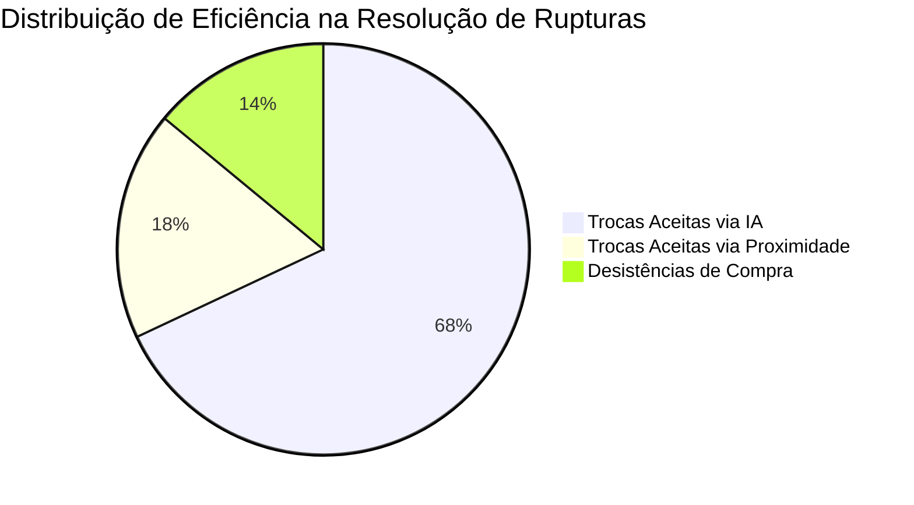

# Dossiê de Coleta de Dados e Telemetria Operacional

> **Eixo de Avaliação:** *Funcionalidade da Solução e Coleta de Dados (15 pontos)*  
> **Finalidade:** Demonstrar como o **Merlin Route Finder** atua como um sistema ativo de sensoriamento e captura de dados operacionais de loja física para a **Leroy Merlin**, superando o conceito de simples catálogo online e fornecendo inteligência em tempo real.

---

## 1. Visão Geral da Estratégia de Coleta de Dados

No varejo físico de grande porte (lojas de 10.000m²), um dos maiores desafios de gestão é a **invisibilidade da jornada do cliente** e o **descompasso de inventário (estoque fantasma)**. 

O cliente visita a loja física, não encontra o produto na prateleira (embora o sistema ERP diga que há estoque), desiste da compra e sai da loja sem deixar qualquer rastro ou dado para a gerência de operações.

O **Merlin Route Finder** transforma cada interação do cliente em um **ponto de coleta de telemetria rica**:

---

## 2. As 4 Dimensões de Dados Coletados

### Dimensão 1: Telemetria de Ruptura de Estoque (`TB_CH26_REGISTRO_RUPTURA`)

*O "Pulo do Gato" da coleta de dados do projeto.*

- **O que é coletado:**
  - `produto_faltante_id`: O produto exato que o cliente procurou na gôndola e não encontrou.
  - `produto_sugerido_id`: O item substituto recomendado pela inteligência espacial e semântica.
  - `origem`: A fonte da recomendação (`ASSISTANT` via IA Gemini ou `PROXIMITY` via distância de gôndola).
  - `justificativa`: O racional semântico da equivalência técnica entre os produtos.
  - `sessao_id` e `registrado_em`: Carimbo de data/hora preciso e correlação com a jornada do cliente.
- **Mecanismo Técnico de Coleta:**
  - Executado via endpoint `POST /api/v1/roteiro/itens/{id}/ruptura`.
  - Gravado com anotação `@Transactional(propagation = Propagation.REQUIRES_NEW)`. Isso assegura que mesmo se a transação do cliente sofrer rollback ou o cliente cancelar o roteiro, a evidência de ruptura na gôndola fica gravada no banco de dados para a equipe de logística.
- **Valor para o Negócio:**
  - **Eliminação do Estoque Fantasma:** Dispara alertas operacionais imediatos para que a equipe de reposição do depósito verifique a gôndola correspondente.
  - **Mapeamento de Demanda Reprimida:** Quantifica quanto dinheiro a loja deixa de faturar por falta de produto físico exposto.

---

### Dimensão 2: Telemetria de Interação Conversacional e Dúvidas Técnicas (`TB_CH26_CHAT_MENSAGEM`)

- **O que é coletado:**
  - `sessao_id`: Agrupamento cronológico da conversa por visitante.
  - `remetente`: Identificação do emissor (`USER` vs `ASSISTANT`).
  - `conteudo`: O texto integral da pergunta em linguagem natural (ex: *"preciso consertar um vazamento no cano PVC, o que compro?"*) e a resposta gerada.
  - `enviado_em`: Timestamp do envio.
- **Mecanismo Técnico de Coleta:**
  - Capturado via `POST /api/v1/chat/{sessaoId}`.
  - Cada interação armazena os termos técnicos pesquisados e os produtos recomendados pelo assistente através de *Function Calling*.
- **Valor para o Negócio:**
  - **Análise Semântica de Necessidades:** Revela quais projetos (ex: impermeabilização, pintura, jardinagem) geram mais insegurança no consumidor.
  - **Capacitação da Força de Vendas:** Orienta os treinamentos dos consultores de loja física sobre os temas mais recorrentes.

---

### Dimensão 3: Telemetria de Jornada, Posição e Tempo de Permanência (`TB_CH26_SESSAO` e `TB_CH26_ITEM_ROTEIRO`)

- **O que é coletado:**
  - `ponto_escaneado_id`: Placa física onde o cliente ingressou na loja (ex: `ENT-01`, `TIN-02`, `FER-01`).
  - `status`: Estado de conclusão da compra (`ACTIVE`, `COMPLETED` no caixa, ou `ABANDONED` por expiração de TTL de 4h).
  - `coletado` e `coletado_em`: Confirmação e momento exato em que o cliente retirou cada produto da gôndola.
  - `expiracao_ttl`: Monitorado pelo serviço agendado `AgendadorDeExpiracao.java`.
- **Mecanismo Técnico de Coleta:**
  - Capturado via `POST /api/v1/sessoes`, `PUT /api/v1/sessoes/{id}/posicao`, `PATCH /api/v1/roteiro/itens/{id}/coletar` e `POST /api/v1/sessoes/{id}/concluir`.
  - No frontend, o módulo `filaDeSincronizacao.js` armazena marcações offline no `localStorage` e as reenvia automaticamente ao restabelecer a conexão.
- **Valor para o Negócio:**
  - **Funil de Conversão Físico:** Mede a proporção entre itens adicionados à lista e itens efetivamente coletados na prateleira.
  - **Tempo Médio de Atendimento:** Permite mensurar a redução no tempo gasto para localizar itens técnicos.

---

### Dimensão 4: Dados Mestres Geoespaciais e Catálogo (`TB_CH26_PRODUTO`, `TB_CH26_PONTO_MAPA`, `TB_CH26_PRODUTO_ATRIBUTO`)

- **O que é coletado e mantido:**
  - Grid normalizado de coordenadas da loja `(X: 0..100, Y: 0..100)`.
  - 111 SKUs reais da Leroy Merlin mapeados por corredor e seção.
  - Atributos dinâmicos por produto (voltagem, bitola, potência, acabamento, rendimento).
- **Mecanismo Técnico de Coleta:**
  - Ingestão gerenciada por `CarregadorDadosIniciais.java`, integrando dados do catálogo e especificações reais da Leroy Merlin.
- **Valor para o Negócio:**
  - Planta digital sempre sincronizada: gôndolas e produtos compartilham o mesmo modelo espacial, evitando mapa desatualizado em relação ao catálogo.

---

## 3. Matriz de Coleta de Dados

| Entidade | Gatilho de Coleta | Campos Principais | Finalidade Operacional |
|---|---|---|---|
| **`TB_CH26_REGISTRO_RUPTURA`** | Cliente clica em "Não encontrei este produto" | `produto_faltante_id`, `produto_sugerido_id`, `origem`, `justificativa`, `registrado_em` | Detecção de divergência de estoque físico e acionamento de reposição. |
| **`TB_CH26_CHAT_MENSAGEM`** | Envio de mensagem no chat do assistente | `sessao_id`, `remetente`, `conteudo`, `enviado_em` | Mapeamento de dúvidas do cliente e refinamento de prompts do assistente. |
| **`TB_CH26_SESSAO`** | Leitura de QR Code ou digitação de placa | `id`, `ponto_escaneado_id`, `status`, `criado_em`, `expiracao_ttl` | Telemetria de fluxo de clientes e taxa de conversão até o caixa. |
| **`TB_CH26_ITEM_ROTEIRO`** | Adição ao carrinho e clique em "Coletar" | `lista_id`, `produto_id`, `coletado`, `coletado_em` | Monitoramento da velocidade de coleta e rotas indoor espontâneas. |

---

## 4. Indicadores de Negócio (KPIs) Gerados para a Gestão da Leroy Merlin

A partir dos dados coletados, a equipe executiva da Leroy Merlin tem acesso a quatro relatórios operacionais estratégicos:

1. **Taxa de Conversão de Ruptura (Rescue Rate):** Percentual de clientes que aceitaram levar o produto substituto em vez de sair da loja de mãos vazias.
2. **Índice de Estoque Fantasma por Seção:** Ranking de setores da loja que mais registram divergência entre saldo do sistema e prateleira física.
3. **Tempo Médio de Jornada de Compra:** Duração entre a leitura do QR Code na entrada e a marcação do último item coletado antes de ir ao caixa.
4. **Mapa de Calor de Dúvidas Técnicas:** Categorias de bricolagem com maior demanda por assistência explicativa no chat.

---

## 5. Conformidade com a Rubrica de Avaliação

- **Funcionalidade da Solução:** A solução não é teórica; possui ingestão de dados em tempo real conectada ao Oracle Database 19c em nuvem e APIs REST com tratamento transacional robusto.
- **Coleta de Dados:** O sistema captura dados críticos na ponta da cadeia de varejo (o corredor físico), transformando a experiência de autoatendimento em uma fonte contínua de inteligência operacional para a Leroy Merlin.
