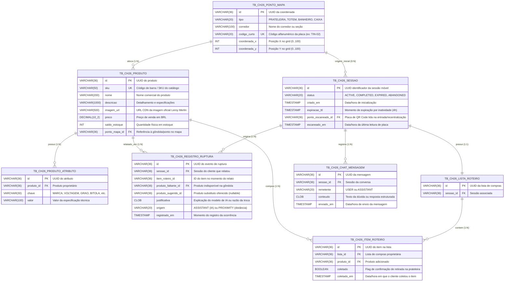

# Diagrama Entidade-Relacionamento (DER) Atualizado — Merlin Route Finder

> **Versão:** 2.1 (12/11/2026: tabelas com o prefixo `TB_CH26_`, ver D-98)  
> **Status:** Mapeamento 1:1 com as tabelas ativas no **Oracle Database 19c**, criadas pelos scripts [`V001__schema_inicial.sql`](../../database/migrations/V001__schema_inicial.sql) e [`V002__prefixo_ch26.sql`](../../database/migrations/V002__prefixo_ch26.sql), nessa ordem (D-94).  
> **Nomes:** `TB_<ID>_<NOME>`, em que o ID identifica a atividade da FIAP dona da tabela: `CH26` = Challenge 2026, FIAP + Leroy Merlin. O schema da FIAP é um por aluno e guarda tabelas de outras atividades; o ID impede que os nomes colidam. Chaves seguem o mesmo padrão: `PK_CH26_...`, `FK_CH26_...`, `UK_CH26_...`.  
> **Substitui:** O PDF preliminar da Sprint 1 (`docs/diagramas/DER.pdf`), que não continha a tabela de telemetria `TB_CH26_REGISTRO_RUPTURA` nem `TB_CH26_PRODUTO_ATRIBUTO`.

---

## 1. Visão Geral do Modelo de Dados

O modelo de dados do **Merlin Route Finder** foi projetado para alta eficiência em consultas geoespaciais e tolerância a falhas na ponta. 

Destaques da modelagem:
1. **Grid Geoespacial Unificado (`TB_CH26_PONTO_MAPA`):** Todas as localizações da loja (gôndolas, placas de QR Code, caixas e sanitários) habitam um grid cartesiano normalizado `(0..100)`, permitindo cálculo de distância euclidiana simples e direto sem conversões de coordenadas.
2. **Telemetria de Ruptura (`TB_CH26_REGISTRO_RUPTURA`):** Registra eventos de gôndola vazia relatados pelos clientes, capturando produto faltante, sugestão de substituto (IA vs proximidade), justificativa e timestamp.
3. **Atributos Dinâmicos Facetados (`TB_CH26_PRODUTO_ATRIBUTO`):** Permite filtros dinâmicos (bitola, voltagem, grão, acabamento) sem colunas esparsas ou nulas em `TB_CH26_PRODUTO`.
4. **Ciclo de Vida de Sessão e Lista (`TB_CH26_SESSAO`, `TB_CH26_LISTA_ROTEIRO`, `TB_CH26_ITEM_ROTEIRO`):** Gerencia sessões móveis com TTL de 4 horas e rastreamento de coletas com carimbo de tempo (`coletado_em`).

---

## 2. Diagrama Entidade-Relacionamento (Mermaid)

---

## 3. Dicionário das Tabelas de Dados

### 3.1. `TB_CH26_PONTO_MAPA`
- **Finalidade:** Modela a geometria física da loja em sistema de coordenadas relativo (0..100).
- **Regras:** `codigo_curto` é único e indexado para resolver rapidamente entradas por QR Code (`TIN-02`, `FER-01`). Pode ser nulo para pontos internos que não possuem placa física (ex: centro de gôndola).

### 3.2. `TB_CH26_PRODUTO`
- **Finalidade:** Catálogo central de itens comercializados na loja física.
- **Regras:** Todo produto possui obrigatoriamente um `ponto_mapa_id` que define a gôndola onde está exposto. O `saldo_estoque` reflete o inventário sistêmico da loja.

### 3.3. `TB_CH26_PRODUTO_ATRIBUTO`
- **Finalidade:** Suporta facetas de busca dinâmica em arquitetura EAV (Entity-Attribute-Value) controlada.
- **Regras:** Constraint única em `(produto_id, chave)`. Permite que categorias diferentes exponham apenas filtros pertinentes (ex: "Grão" em Tintas, "Voltagem" em Ferramentas).

### 3.4. `TB_CH26_SESSAO`
- **Finalidade:** Rastreamento do ciclo de vida da jornada do cliente no navegador móvel.
- **Regras:** O TTL padrão é de 4 horas com renovação a cada interação. A sessão pode ser iniciada mesmo com código de placa desconhecido (`ponto_escaneado_id = null`), permitindo navegação sem "você está aqui".

### 3.5. `TB_CH26_LISTA_ROTEIRO` e `TB_CH26_ITEM_ROTEIRO`
- **Finalidade:** Carrinho de compras indoor sem limite fixo de produtos.
- **Regras:** `TB_CH26_ITEM_ROTEIRO` armazena o status de coleta física (`coletado`) e carimbo de data/hora (`coletado_em`), possibilitando calcular a velocidade de coleta e deduzir a posição estimada do cliente.

### 3.6. `TB_CH26_CHAT_MENSAGEM`
- **Finalidade:** Auditoria e memória conversacional do assistente de inteligência artificial.
- **Regras:** Registra todas as mensagens trocadas entre o usuário e o modelo generativo Gemini, mantendo o histórico ordenado por sessão.

### 3.7. `TB_CH26_REGISTRO_RUPTURA` (Telemetria Crítica)
- **Finalidade:** Captura de descompasso de estoque físico vs sistêmico em tempo real na gôndola.
- **Regras:** Persistido em transação isolada (`REQUIRES_NEW`), garantindo que a evidência de ruptura seja gravada no banco mesmo que o cliente desista ou altere o item em seguida. Guarda o motivo da sugestão e a origem (`ASSISTANT` ou `PROXIMITY`).
