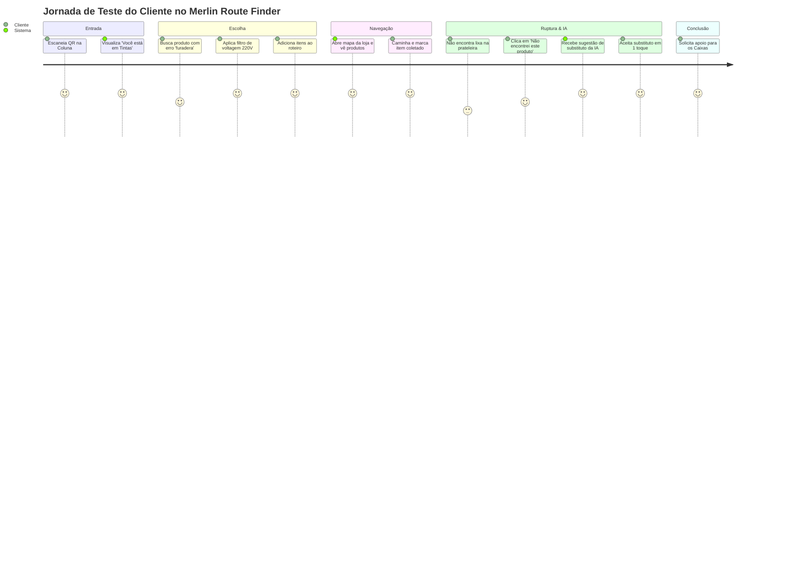

# Guia de Avaliação e Teste Prático do MVP — Merlin Route Finder

> **Avaliadores:** Professores FIAP e Representantes Técnicos da Leroy Merlin  
> **Objetivo:** Fornecer um roteiro guiado, direto e reproduzível para testar as principais funcionalidades do MVP em produção, comprovando a **Implementação da Solução (10 pontos)** e a **Usabilidade e Experiência do Usuário (5 pontos)**.

---

## 1. Ambientes e Links Oficiais de Demonstração

| Recurso | URL em Produção | Observações |
|---|---|---|
| **Mobile Web App (Frontend)** | [`https://merlin-route-finder.vercel.app`](https://merlin-route-finder.vercel.app) | Publicado na Vercel. Responsivo para smartphone ou navegador desktop. |
| **API REST (Backend)** | [`https://merlin-route-finder-api.onrender.com/health`](https://merlin-route-finder-api.onrender.com/health) | Publicado no Render com Java 21, JAX-RS (Jersey) e Oracle 19c, seguindo o material da FIAP. O `/health` responde sem tocar no banco. |
| **Contrato da API** | [`openapi.yaml`](../backend/src/main/resources/openapi/openapi.yaml) | OpenAPI 3.0 com todos os endpoints documentados. Para chamar a API sem o app, há uma coleção do Insomnia em [`insomnia/merlin-paridade.json`](insomnia/merlin-paridade.json). |

> [!TIP]
> **Partida a Frio do Backend (Cold Start):**
> O backend está hospedado no plano gratuito do Render. Caso a instância esteja ociosa há mais de 15 minutos, a primeira requisição levará cerca de **90 a 110 segundos** para acordar o processo Java. O aplicativo web detecta essa espera automaticamente e exibe uma barra informativa: *"Preparando o sistema… a primeira abertura do dia leva até dois minutos."* Depois de acordado, cada resposta leva menos de um segundo (de 0,4 s a 0,7 s, medido em 12/11/2026).

---

## 2. Roteiro Passo a Passo de Teste do Fluxo Principal

Este roteiro reproduz a jornada real de um cliente na loja física da Leroy Merlin:

---

### Passo 1: Entrada na Loja e Ponto de Partida

1. **Acesso com QR Code Simulado:**
   - Acesse a URL direta com o código do corredor de tintas:  
     👉 [`https://merlin-route-finder.vercel.app/?ponto=TIN-02`](https://merlin-route-finder.vercel.app/?ponto=TIN-02)
   - *O que observar:* O sistema inicia uma nova sessão sem pedir login/senha e exibe no topo o chip de localização: **"Você está em: Corredor de Tintas"**.
2. **Plano B (Digitação Manual do Código):**
   - Caso acesse a URL raiz [`https://merlin-route-finder.vercel.app`](https://merlin-route-finder.vercel.app), toque no chip de localização ou em "Digitar código" e insira `TIN-02` ou `FER-01`.
   - *O que observar:* O mapa se ajusta imediatamente à coluna indicada.

---

### Passo 2: Catálogo, Busca Tolerante a Falhas e Filtros Facetados

1. **Busca Fuzzy (Tolerante a Erros de Digitação):**
   - Na barra de busca, digite propositalmente com erros de grafia: `"furadera"` ou `"tnta"`.
   - *O que observar:* A busca nativa via `UTL_MATCH` do Oracle recupera corretamente **"Parafusadeira / Furadeira"** e as **Tintas**, demonstrando robustez no uso prático por clientes leigos.
2. **Filtros Dinâmicos Facetados:**
   - Acesse o setor **"Tintas"** ou **"Ferramentas"** e abra o menu de filtros.
   - *O que observar:* As facetas são dinâmicas — em Ferramentas aparecem filtros de *Voltagem* e *Marca*; em Tintas aparecem *Acabamento* e *Rendimento*.

---

### Passo 3: Montagem da Lista de Compras (Local-First)

1. Adicione 3 produtos à sua lista tocando no botão **"+"** dos cartões:
   - *Exemplo 1:* `Lixa para Parede Grão 120` (Setor Tintas)
   - *Exemplo 2:* `Rolo de Pintura Antigota 23cm` (Setor Tintas)
   - *Exemplo 3:* `Fita Crepe 24mm x 50m` (Setor Tintas)
2. Abra a aba **"Roteiro"** na barra inferior (`BottomNav`).
   - *O que observar:* Lista de itens organizada, estimativa do valor total da compra em BRL e ausência de limites artificiais de quantidade (preparado tanto para o cliente B2C pontual quanto para o profissional B2B de grandes reformas).

---

### Passo 4: O Mapa Interativo da Loja

1. Toque na aba **"Mapa"** da barra inferior.
2. *O que observar:*
   - A planta vetorial da loja com corredores identificados.
   - O **marcador azul do cliente** posicionado na entrada/coluna informada (`TIN-02`).
   - Marcadores destacados para cada produto da lista de compras.
   - Ao tocar em um marcador no mapa, um card exibe o nome do produto e a seção.

---

### Passo 5: O Pulo do Gato — Ruptura de Estoque ("Prateleira Vazia") com IA

Este é o momento mais inovador da solução: resolver a frustração do cliente diante da gôndola desabastecida.

1. No roteiro de compras, localize o item **`Lixa para Parede Grão 120`**.
2. Toque no botão **"Não encontrei este produto"** (ou ícone de alerta de prateleira vazia).
3. Aguarde a análise da inteligência artificial (Gemini 3.5 Flash-Lite com grounding no inventário local).
4. *O que observar:*
   - O modal de ruptura se abre exibindo o selo **"Sugestão do assistente"**.
   - O produto sugerido será a **`Lixa d'Água Grão 150`** (disponível no mesmo corredor de Tintas, R$ 4,20).
   - O assistente apresenta uma **justificativa técnica em linguagem natural**, explicando que a lixa d'água grão 150 possui granulometria próxima e cumpre perfeitamente o acabamento para pintura de paredes.
5. Toque no botão **"Levar este"**:
   - *O que observar:* Em **uma única ação atômica**, a lixa faltante é removida da lista e a lixa substituta é inserida, atualizando o mapa e gravando o evento na tabela `TB_REGISTRO_RUPTURA` do Oracle.

---

### Passo 6: Consultoria Conversacional com Assistente de IA

1. Toque no ícone do **Assistente** na barra inferior ou no botão flutuante.
2. Digite uma pergunta aberta de projeto, por exemplo:
   - *"O que eu preciso para pintar uma parede de gesso?"*
3. *O que observar:*
   - O assistente responde de forma consultiva, indicando os materiais necessários (fundo preparador, rolo, lixa, tinta acrílica).
   - O modelo utiliza *Function Calling* estrito contra o catálogo do banco de dados: **ele só cita produtos e corredores reais existentes nesta loja física**, eliminando o risco de alucinação.

---

### Passo 7: Coleta Física, Resiliência e Conclusão nos Caixas

1. Na lista de compras, toque no checkbox para marcar itens como **"Coletados"**.
   - *O que observar:* O item ganha marcação visual e sua coordenada passa a atualizar a posição estimada do cliente.
2. Caso desmarque o item, a posição retorna com segurança para a referência anterior.
3. Toque no botão **"Encerrar Jornada"**:
   - O sistema pergunta se o cliente deseja ser guiado até os caixas de pagamento.
   - Ao confirmar, o mapa destaca os **pontos de Caixa / Saída da loja**, concluindo a sessão com status `COMPLETED` no Oracle.

---

## 3. Matriz de Cobertura dos Critérios da Rubrica

| Pergunta da Rubrica | Evidência Comprovada no MVP |
|---|---|
| **O MVP apresenta uma versão funcional que demonstra a proposta de valor?** | Sim. Aplicação 100% implantada em nuvem, resolvendo o autoatendimento e a localização indoor sem download de app. |
| **Existe um fluxo básico de uso que permita testar as principais funcionalidades?** | Sim. Fluxo de 7 passos percorrível em menos de 4 minutos cobrindo entrada, busca, mapa, lista, ruptura/IA, chat e checkout. |
| **A solução resolve o problema de forma clara e aplicável?** | Sim. Dispensa totens caros de hardware e adota placas simples de QR Code já familiares aos clientes. Salva vendas através da substituição inteligente de produtos em ruptura. |
| **A interface do MVP é intuitiva e de fácil navegação?** | Sim. Barra inferior com 4 destinos canônicos, chip de localização visível e breadcrumbs. |
| **As interações são bem organizadas para o usuário final?** | Sim. Troca de produto em ruptura com 1 toque; lista local-first que não perde dados sem conexão. |
| **O design contribui para uma experiência fluida e eficiente?** | Sim. Cores institucionais Leroy Merlin aprovadas em contraste WCAG, suporte a redução de movimento e mapa vetorial de resposta instantânea. |
